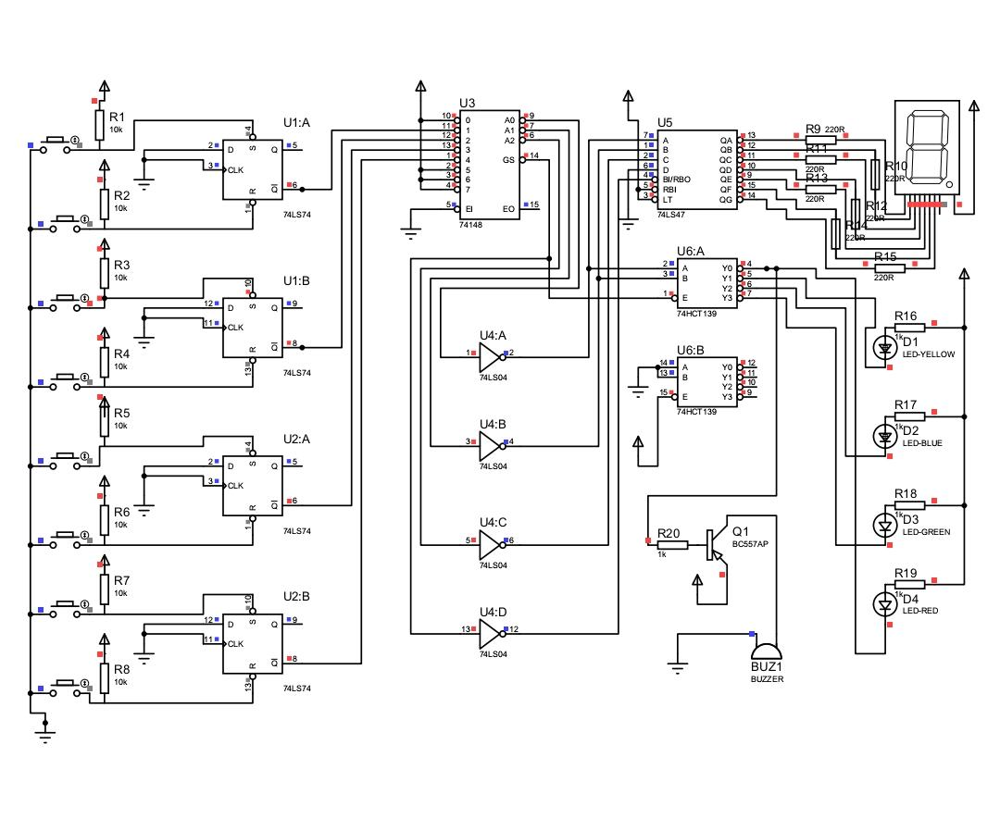
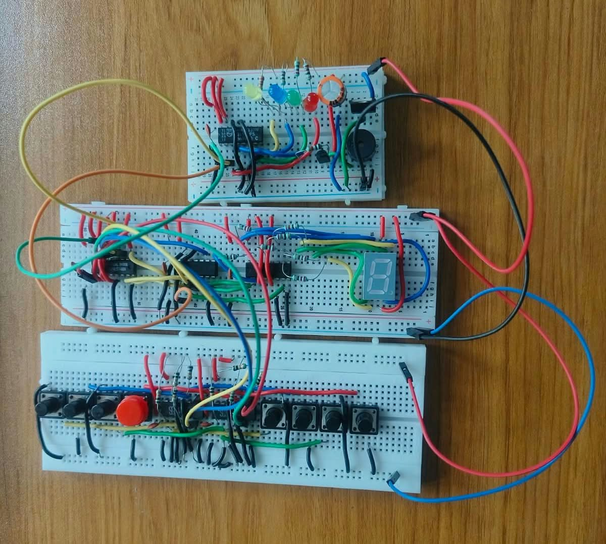

# Smart Patient Nursing-Call and Priority Alert System

A digital logic-based patient nursing-call system designed to manage patient assistance requests using call storage, priority encoding, visual indication, and audible alerts.

## Overview

The **Smart Patient Nursing-Call and Priority Alert System** is a digital electronics project designed to help nursing staff identify and manage patient assistance requests in an organized manner. The system supports four patient beds, each provided with a CALL button and a CLEAR button.

When a patient presses the CALL button, the request is stored using D-type flip-flops. If multiple calls are active simultaneously, a priority encoder selects the highest-priority request. The selected bed number is displayed on a common-anode seven-segment display, while a corresponding LED provides visual indication. A buzzer is used to provide an audible alert.

The project is designed using digital integrated circuits without a microcontroller. The circuit diagram and simulation were developed using Proteus 8 Professional.

## Objectives

- To design a digital logic-based patient nursing-call system.
- To store individual patient call requests using flip-flops.
- To implement priority-based selection for multiple simultaneous calls.
- To display the selected bed number using a seven-segment display.
- To provide visual alerts through individual bed LEDs.
- To provide an audible alert using a buzzer.
- To demonstrate the practical application of sequential and combinational logic circuits.

## Features

- Supports four patient beds.
- Individual CALL and CLEAR buttons for each bed.
- Call request storage using 74LS74 flip-flops.
- Priority selection using the 74LS148 priority encoder.
- Fixed priority order: **Bed 4 > Bed 3 > Bed 2 > Bed 1**.
- Seven-segment display for selected bed number.
- Individual LED indication for the selected bed.
- Buzzer-based audible alert.
- No microcontroller required.
- Circuit design and simulation using Proteus 8 Professional.

## Components Used

| Component | Quantity | Function |
|---|---:|---|
| 74LS74 Dual D-Type Flip-Flop | 2 | Stores four patient call requests |
| 74LS148 8-to-3 Priority Encoder | 1 | Selects the highest-priority active call |
| 74LS04 Hex Inverter | 1 | Inverts active-low logic signals |
| 74LS47 BCD-to-7-Segment Driver | 1 | Drives the common-anode display |
| 74HCT139 Dual 2-to-4 Decoder | 1 | Selects the corresponding bed LED |
| Common-Anode 7-Segment Display | 1 | Displays the selected bed number |
| Push Buttons | 8 | Four CALL and four CLEAR buttons |
| LEDs | 4 | Visual bed indication |
| BC557 PNP Transistor | 1 | Switches the buzzer |
| Active Buzzer | 1 | Provides audible alert |
| 220 Ω Resistors | 7 | Current limiting for display segments |
| 1 kΩ Resistors | 4 | Current limiting for bed LEDs |
| 10 kΩ Resistors | 8 | Pull-up resistors for button inputs |
| 2.2 kΩ Resistor | 1 | Transistor base resistor |
| 100 nF Capacitors | 5 | Recommended IC supply decoupling |
| Regulated 5V DC Supply | 1 | Powers the digital logic circuit |

## Block Diagram

The system is divided into the following functional blocks:

1. **Patient Call Inputs:** CALL and CLEAR buttons are provided for each bed.
2. **Call Memory:** The 74LS74 flip-flops store the individual call requests.
3. **Priority Selection:** The 74LS148 selects the highest-priority active call.
4. **Logic Inversion:** The 74LS04 converts active-low encoder outputs into normal logic levels.
5. **Display Unit:** The 74LS47 drives the seven-segment display.
6. **Bed LED Indication:** The 74HCT139 selects the corresponding bed indicator.
7. **Audible Alert:** The BC557 transistor controls the buzzer.

## Circuit Diagrams

### Block Diagram

### Complete Schematic Diagram

### Wiring Diagram

### Emergency Call Circuit

## Pin Connections

### 1. 74LS74 – Call Memory

Two 74LS74 ICs are used to store the call requests from four beds.

| Signal | Connection |
|---|---|
| PRE (active-low) | CALL button control |
| CLR (active-low) | CLEAR button control |
| D | Logic LOW |
| CLK | Logic LOW |
| Q | Stored call status |
| Q̅ | Active-low input to 74LS148 |
| VCC | +5V |
| GND | 0V |

Each flip-flop stores the request for one bed. The active-low preset and clear inputs are used to set and reset the stored call state.

### 2. 74LS148 – Priority Encoder

| Bed | 74LS148 Input Pin |
|---|---:|
| Bed 1 | 11 |
| Bed 2 | 12 |
| Bed 3 | 13 |
| Bed 4 | 1 |

| Signal | Pin |
|---|---:|
| Enable Input (EI) | 5 |
| Group Signal (GS) | 14 |
| Output A0 | 9 |
| Output A1 | 7 |
| Output A2 | 6 |
| VCC | 16 |
| GND | 8 |

The 74LS148 receives active-low call signals and selects the highest-priority input.

### 3. 74LS04 – Hex Inverter

| Input | Output |
|---|---|
| Pin 1 | Pin 2 |
| Pin 3 | Pin 4 |
| Pin 5 | Pin 6 |
| Pin 9 | Pin 8 |

The inverter converts the active-low outputs of the priority encoder into normal logic levels for the display and indicator circuits.

### 4. 74LS47 – Seven-Segment Display Driver

| 74LS47 Pin | Function |
|---:|---|
| 7 | A |
| 1 | B |
| 2 | C |
| 6 | D |
| 13 | Segment a |
| 12 | Segment b |
| 11 | Segment c |
| 10 | Segment d |
| 9 | Segment e |
| 15 | Segment f |
| 14 | Segment g |
| 16 | VCC |
| 8 | GND |

The seven-segment display used in the project is common-anode. Each segment output is connected through a current-limiting resistor.

### 5. 74HCT139 – Bed LED Decoder

The first decoder section of the 74HCT139 is used to select one of the four bed LEDs.

| 74HCT139 Pin | Connection |
|---:|---|
| 1 | Active-low enable signal |
| 2 | Selection input A |
| 3 | Selection input B |
| 4 | Output Y0 |
| 5 | Output Y1 |
| 6 | Output Y2 |
| 7 | Output Y3 |
| 16 | VCC |
| 8 | GND |

The outputs are active-low. The selected output sinks current and turns ON the corresponding LED.

**Note:** The output-to-bed mapping must match the binary selection signals generated by the priority encoder and inverter circuit.

### 6. BC557 – Buzzer Driver

| Transistor Terminal | Connection |
|---|---|
| Emitter | +5V |
| Base | Control signal through 2.2 kΩ resistor |
| Collector | Positive terminal of buzzer |
| Buzzer negative terminal | GND |

The BC557 PNP transistor acts as an electronic switch to control the buzzer.

## Working Principle

### Step 1: Patient Call

When a patient presses the CALL button, the corresponding 74LS74 flip-flop is set. The call request remains stored even after the button is released.

### Step 2: Priority Selection

The stored call signals are provided to the 74LS148 priority encoder. If multiple calls are active, the encoder selects the highest-priority request.

The priority order is:

**Bed 4 > Bed 3 > Bed 2 > Bed 1**

### Step 3: Output Processing

The active-low output signals of the 74LS148 are inverted using the 74LS04. These signals are then supplied to the display and bed LED selection circuits.

### Step 4: Bed Number Display

The 74LS47 receives the selected bed code and drives the common-anode seven-segment display to show the corresponding bed number.

### Step 5: LED Indication

The 74HCT139 decodes the selection signals and activates the corresponding bed LED. The LED provides a visual indication of the selected bed.

### Step 6: Audible Alert

The buzzer is controlled through the BC557 PNP transistor. When the alert control signal activates the transistor, the buzzer produces an audible alert.

### Step 7: Call Reset

When the nursing staff presses the CLEAR button for a bed, the corresponding flip-flop is reset. If other calls remain active, the priority encoder selects the next highest-priority request.

## Priority Truth Table

| Active Bed Call | Selected Bed | Binary Output |
|---|---|---|
| Bed 1 | Bed 1 | 001 |
| Bed 2 and Bed 1 | Bed 2 | 010 |
| Bed 3, Bed 2, and Bed 1 | Bed 3 | 011 |
| Bed 4 and any lower-priority beds | Bed 4 | 100 |
| No active calls | No selection | Display blank |

The truth table demonstrates how the priority encoder selects the highest-priority active bed.

## Simulation Using Proteus

Proteus 8 Professional was used to design the circuit schematic and simulate the operation of the system. The virtual push buttons were used to test individual and simultaneous patient calls.

The simulation helped verify:

- Call request storage.
- Priority encoder operation.
- Correct bed number display.
- Corresponding LED selection.
- Call reset operation.
- No-call display and alert condition.

The simulation provides a convenient way to examine the circuit behaviour before or alongside physical hardware implementation.

## Simulation Results

### When Bed 1 Is Calling

### When Bed 2 Is Calling

### Wiring and Circuit Setup

## Working Video

The working video and project demonstration are available through the Google Drive link below.

[**Watch the Working Video – Google Drive**](https://drive.google.com/drive/folders/1LPlI-qz2lNhpd47RVcTvAiv5m2ph3a8g?usp=sharing)

## Advantages

- Simple and cost-effective digital logic design.
- No microcontroller required.
- Individual call storage for each bed.
- Priority-based handling of multiple requests.
- Clear visual indication through LEDs and display.
- Audible alert for patient assistance requests.
- Demonstrates practical digital electronics concepts.

## Limitations

- Supports only four beds in the current design.
- Uses a fixed priority order based on bed number.
- Does not determine medical urgency automatically.
- Requires a reliable 5V regulated supply.
- The prototype is not a certified medical device.

## Future Scope

The system can be improved and extended in several ways:

- **Expansion to More Beds:** Additional priority encoder and memory circuits can be incorporated to support more patient beds.
- **Call Acknowledgement:** A separate acknowledgement function can indicate that the nursing staff has received the call.
- **Multiple Call Indication:** Additional LEDs or displays can indicate all pending calls instead of only the highest-priority call.
- **Adjustable Priority:** The priority order can be modified according to patient urgency rather than a fixed bed number.
- **Wireless Notification:** Wireless communication can be added to send patient call notifications to nursing staff.
- **Centralized Monitoring:** A central monitoring unit can be developed to track calls from multiple wards.
- **Power Backup:** A backup supply can be incorporated to maintain operation during power interruptions.
- **Improved Safety:** Additional fault detection and testing can be introduced for reliable operation in healthcare environments.

## Conclusion

The Smart Patient Nursing-Call and Priority Alert System demonstrates how digital logic circuits can be used to manage patient assistance requests in an organized manner. The project combines flip-flop-based call storage, priority encoding, display decoding, LED indication, and buzzer control.

The system selects the highest-priority active call and indicates the corresponding bed number. It provides a practical demonstration of sequential and combinational logic and can serve as a foundation for further development of patient monitoring and nursing-call systems.

## References

1. Texas Instruments, *SN74LS74A Dual Positive-Edge-Triggered D-Type Flip-Flops with Preset and Clear*, Datasheet.
2. Texas Instruments, *SN74LS148 8-Line to 3-Line Priority Encoder*, Datasheet.
3. Texas Instruments, *SN74LS04 Hex Inverters*, Datasheet.
4. Texas Instruments, *SN74LS47 BCD-to-7-Segment Decoder/Driver*, Datasheet.
5. Texas Instruments, *SN74HCT139 Dual 2-to-4 Line Decoder/Demultiplexer*, Datasheet.
6. All About Circuits, *Digital Circuits Textbook*. https://www.allaboutcircuits.com/textbook/digital/
7. Labcenter Electronics, *Proteus Design Suite*. https://www.labcenter.com/

## Author

Developed as an academic digital electronics project.

